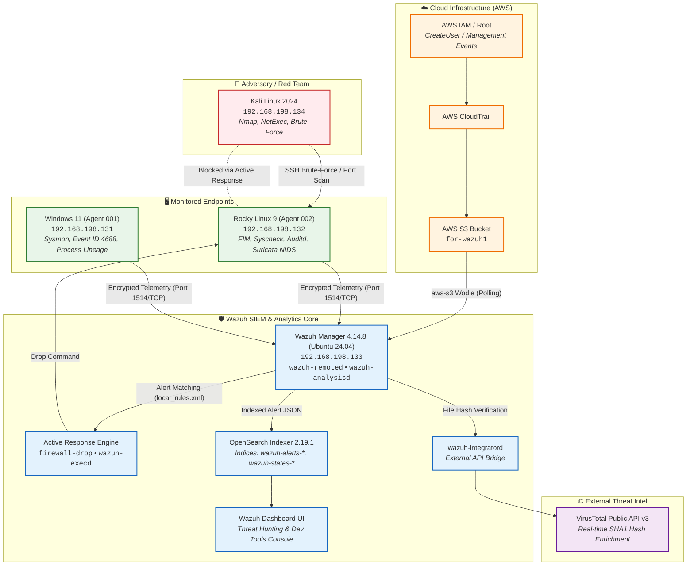

<div align="center">


# 🛡️ The 10 Tasks to Master Wazuh
### *From Blind Copy-Paste to Production Detection Engineering, Threat Hunting, and Active Defense*

[](https://wazuh.com/)
[](https://opensearch.org/)
[](https://attack.mitre.org/)
[](LICENSE)
[](https://github.com/mahialjaber)

<br/>

**A complete, battle-tested defensive engineering portfolio showcasing the end-to-end implementation, configuration, attack simulation, detection validation, and tuning of Wazuh in an enterprise hybrid environment.**

[Explore Tasks](#-the-10-task-catalog) • [Architecture](#-lab-architecture--telemetry-flow) • [Detection Rules](#-production-detection-rules) • [DQL Hunting](#-threat-hunting-dql--api-library)

</div>

---

## 📌 Executive Statement: Why This Repository Exists

Most security tutorials teach superficial button-clicking: installing an agent, running a script, and staring at a pre-built dashboard. In real-world enterprise Security Operations Centers (SOCs), that breaks down the moment:
1. An attacker modifies a production binary and you need **sub-second differential telemetry**.
2. Alert fatigue floods your analysts with hundreds of benign scanner alerts requiring **scoped suppression (`level="0"`)**.
3. Active defense commands fail because **agent execution targets** (`<location>local</location>` vs `<location>defined-agent</location>`) were misconfigured.
4. You need to pull vulnerable CVEs programmatically using raw **OpenSearch Dev Tools REST queries** rather than clicking around the GUI.

This repository documents the unassisted execution and verification of **10 rigorous, enterprise-grade challenges** across AWS CloudTrail, Rocky Linux 9, Windows 11 Enterprise, Suricata NIDS, VirusTotal Threat Intel, and Kali Linux attack simulations. Every scenario was tested end-to-end to build defensible detection engineering and threat hunting expertise.

---

## 🏗️ Lab Architecture & Telemetry Flow

The validation environment mirrors a modern hybrid enterprise network with endpoint telemetry, network IDS, cloud management logs, and external threat intelligence APIs.



> 📖 *For complete daemon architectures, socket paths, and deep dive diagrams, see [architecture/telemetry-pipeline.md](architecture/telemetry-pipeline.md).*

---

## 📂 The 10-Task Catalog

Each task represents an independent defensive module complete with attack simulations, configs, and ground-truth telemetry proof.

| # | Domain / Title | Target System | Core Mechanism / Rule | Evidence & Metric | Detailed Report |
| :-: | :--- | :--- | :--- | :--- | :-: |
| **01** | **Cloud Security (CSPM / CloudTrail)** | AWS S3 & IAM | Rule `80202` (`CreateUser`), `aws-s3` wodle | Real root `CreateUser` event in OpenSearch | [📘 Task 01](tasks/task-01-aws-cloudtrail-audit/README.md) |
| **02** | **Real-Time FIM & Differential Analysis** | Rocky Linux 9 | Rule `550` (FIM Tampering), `syscheck` diff | Binary `/usr/bin/tty` tampering captured | [📘 Task 02](tasks/task-02-realtime-fim-differential/README.md) |
| **03** | **Detection Engineering (PCRE2 Rules)** | Ubuntu Manager | Custom Rule `100025`, `wazuh-logtest` | Regex matches `whoami /priv` & `/etc/shadow` | [📘 Task 03](tasks/task-03-detection-engineering-rules/README.md) |
| **04** | **Threat Intelligence Enrichment** | Rocky Linux 9 | Rule `87105`, VirusTotal API v3 | EICAR hash detected by 66/68 engines | [📘 Task 04](tasks/task-04-virustotal-threat-intel/README.md) |
| **05** | **Active Defense & IP Containment** | Rocky Linux 9 | Rule `5712`/`5720`, `firewall-drop` script | Kali SSH blocked via NetExec containment | [📘 Task 05](tasks/task-05-active-defense-ip-blocking/README.md) |
| **06** | **SOC Threat Hunting via DQL** | OpenSearch SIEM | Boolean DQL Filter (`rule.level >= 8...`) | 42 high-risk alerts isolated from noise | [📘 Task 06](tasks/task-06-soc-threat-hunting-dql/README.md) |
| **07** | **Windows Deep Telemetry Correlation** | Windows 11 Ent | Event ID 4688 vs Sysmon Event ID 1 | `services.exe` ➔ `svchost.exe` lineage | [📘 Task 07](tasks/task-07-windows-process-lineage/README.md) |
| **08** | **NIDS + HIDS Telemetry Correlation** | Rocky Linux 9 | Suricata `eve.json`, Rule `86601` | Nmap scan decoded at network & host tier | [📘 Task 08](tasks/task-08-suricata-nids-correlation/README.md) |
| **09** | **Vulnerability Posture & Dev Tools API** | OpenSearch API | Dev Tools REST API (`_search` DSL) | `CVE-2026-72130` (8.8) & `CVE-2025-41244` (7.8) | [📘 Task 09](tasks/task-09-vulnerability-hunting-api/README.md) |
| **10** | **False Positive Tuning (Noise Reduction)** | Ubuntu Manager | Child Rule `100060` (`level="0"`), `if_sid` | Silenced Kali IPv6 ping, perimeter guarded | [📘 Task 10](tasks/task-10-false-positive-tuning/README.md) |

---

## ⚡ Standout Engineering Breakthroughs

* **Tier-3 OpenSearch Dev Tools Querying (Task 09):** Bypassed GUI limitations by writing raw Elasticsearch/OpenSearch JSON REST queries against `wazuh-states-vulnerabilities-*` to programmatically extract the highest-severity CVEs across heterogeneous endpoints.
* **5-Hour Active Defense Root Cause Debugging (Task 05):** Uncovered the critical difference between `<location>local</location>` (manager-side blocking) and `<location>defined-agent</location>` (targeted endpoint blocking), successfully mitigating Kali Linux NetExec brute force at the Linux kernel level.
* **Production Alert Fatigue Tuning (Task 10):** Addressed the #1 operational issue in modern SOCs by engineering a surgical `level="0"` suppression rule anchored to exact IPv6 addresses, reducing benign scanner noise to zero while preserving alerting for genuine threats.
* **Sub-Second Binary FIM Differential Analysis (Task 02):** Validated inotify differential reporting against modified production binaries in `/usr/bin/`, confirming integrity monitoring without crashing the `syscheck` engine.

---

## 💻 Production Detection Rules

All custom rules authored during this project are located in [`detections/local_rules.xml`](detections/local_rules.xml):

```xml
<group name="local,syslog,sshd,custom_detection,">

  <!-- TASK 03: Privilege Escalation & Credential Access Detection -->
  <rule id="100025" level="10">
    <description>Suspicious command execution: whoami /priv (Windows) or cat /etc/shadow (Linux)</description>
    <regex type="pcre2">(?i)(whoami(\.exe)?\s+/priv|cat\s+/etc/shadow)</regex>
    <mitre>
      <id>T1033</id>
      <id>T1003.008</id>
    </mitre>
  </rule>

  <!-- TASK 05: Active Response Trigger for SSH Brute Force -->
  <rule id="100001" level="10" frequency="5" timeframe="120">
    <if_matched_sid>5710</if_matched_sid>
    <same_source_ip />
    <description>sshd: Multiple failed logins from same source IP (AR Trigger)</description>
    <mitre>
      <id>T1110.001</id>
    </mitre>
  </rule>

  <!-- TASK 10: Suricata NIDS False Positive Suppression Rule -->
  <rule id="100060" level="0">
    <if_sid>86601</if_sid>
    <field name="alert.signature_id">^9000001$</field>
    <field name="src_ip">^fe80:0000:0000:0000:1467:52f3:5b1b:b3f2$</field>
    <description>Ignore Kali test ping alerts from specific IPv6</description>
  </rule>

</group>
```

---

## 🔎 Threat Hunting DQL & API Library

The repository includes a curated library of production threat hunting queries:

* **[queries/dql-hunting-queries.md](queries/dql-hunting-queries.md):** 15+ production DQL queries covering:
  * High-Severity Noise-Filtered Triage (`rule.level >= 8 and not agent.id: "000"...`)
  * Kerberoasting & Golden Ticket Indicators (Event ID 4769)
  * Process Lineage Masquerading (`svchost.exe` spawning PowerShell)
  * CloudTrail IAM Privilege Escalation (`AttachUserPolicy`, `CreateAccessKey`)
  * Suricata High-Severity NIDS Exploitation
* **[queries/opensearch-devtools-api.json](queries/opensearch-devtools-api.json):** Raw REST API JSON queries for the OpenSearch Dev Tools console.

---

## 📊 Implementation & Telemetry Verification Matrix

| Competency Area | Implementation & Validation Summary | Status |
| :--- | :--- | :---: |
| **Cloud SIEM (AWS)** | Integrated S3, CloudTrail, IAM policies, and monitored management API actions (`CreateUser` Rule 80202). | **Verified** |
| **Endpoint Detection (EDR/FIM)** | Configured real-time inotify monitoring, differential reporting, and binary tampering detection (`/usr/bin/tty` Rule 550). | **Verified** |
| **Detection Engineering** | Authored PCRE2 regex rules, mapped MITRE ATT&CK techniques, and validated with `wazuh-logtest` (Rule 100025). | **Verified** |
| **Threat Intelligence** | Connected VirusTotal API v3, processed automated EICAR submissions, and evaluated engine detections (Rule 87105). | **Verified** |
| **Network Security (NIDS)** | Integrated Suricata `eve.json` into Wazuh, monitored Nmap scans, and parsed packet signatures (Rule 86601). | **Verified** |
| **Threat Hunting & DQL** | Crafted boolean DQL queries, generated visual aggregations, and isolated 42 high-risk alerts from endpoint noise. | **Verified** |
| **Database & API Querying** | Utilized OpenSearch Dev Tools REST console to query indices with multi-field descending sorting. | **Verified** |
| **SOC Operations & Tuning** | Diagnosed alert noise and authored precision `level="0"` suppression rules for authorized probes (Rule 100060). | **Verified** |
| **Active Defense (Remediation)** | Diagnosed `firewalld`, `iptables-nft`, and active response location logic for dynamic IP blocking (Rule 5712, 100011). | **Verified** |

---

## 📁 Repository Structure

```text
the-10-task-to-master-wazuh/
├── README.md                                # Master showcase documentation
├── LICENSE                                  # MIT License
├── .gitignore                               # OS and editor cleanliness rules
├── architecture/
│   ├── README.md                            # Complete lab topology, IP plan, node roles
│   └── telemetry-pipeline.md                # Daemon breakdown, logtest phases, AR flows
├── tasks/
│   ├── task-01-aws-cloudtrail-audit/        # AWS S3, IAM, CloudTrail, Rule 80202
│   ├── task-02-realtime-fim-differential/   # /usr/bin/tty tampering, binary diff, Rule 550
│   ├── task-03-detection-engineering-rules/ # PCRE2 rule 100025, MITRE T1033/T1003.008
│   ├── task-04-virustotal-threat-intel/     # EICAR drop, VT API v3, Rule 87105 (66/68)
│   ├── task-05-active-defense-ip-blocking/  # NetExec SSH attack, firewall-drop, troubleshooting
│   ├── task-06-soc-threat-hunting-dql/      # DQL boolean filtering, 42 high-risk hits
│   ├── task-07-windows-process-lineage/     # Event ID 4688 vs Sysmon Event ID 1, 492 events
│   ├── task-08-suricata-nids-correlation/   # Suricata eve.json, Rule 86601, Nmap scan
│   ├── task-09-vulnerability-hunting-api/   # Dev Tools REST API, CVE-2026-72130, CVE-2025-41244
│   └── task-10-false-positive-tuning/       # Child rule 100060 (level="0"), noise reduction
├── detections/
│   ├── README.md                            # Detection engineering documentation
│   └── local_rules.xml                      # Production-ready custom Wazuh rules
├── queries/
│   ├── dql-hunting-queries.md               # 15+ production OpenSearch DQL queries
│   └── opensearch-devtools-api.json         # Raw REST API search queries
├── configs/
│   ├── ubuntu-manager/                      # Manager ossec.conf (sanitized)
│   ├── windows-11-agent/                    # Windows agent ossec.conf, audit policies, sysmon
│   └── rocky-linux-agent/                   # Linux agent ossec.conf, audit.rules, suricata.yaml
├── mitre-attack/
│   └── MITRE_MAPPING.md                     # Comprehensive MITRE ATT&CK Matrix mapping
└── assets/
    ├── banner.jpg                           # Showcase header banner
    └── screenshots/                         # 31 curated, cropped, OPSEC-redacted screenshots
```

---

## 👤 Author & Acknowledgements

> **Built with defensive precision.** If you find this repository valuable for your SOC career, please consider starring ⭐ the repository!

* **Author:** Mahi Al Jaber ([@mahialjaber](https://github.com/mahialjaber))
* **Email:** [mahialjaber.dev@gmail.com](mailto:mahialjaber.dev@gmail.com)
* **Related Projects:**
  * [SOC-Log-Analysis-Datasets](https://github.com/mahialjaber/SOC-Log-Analysis-Datasets) — *30+ ⭐ Enterprise Detection & Telemetry Datasets*
