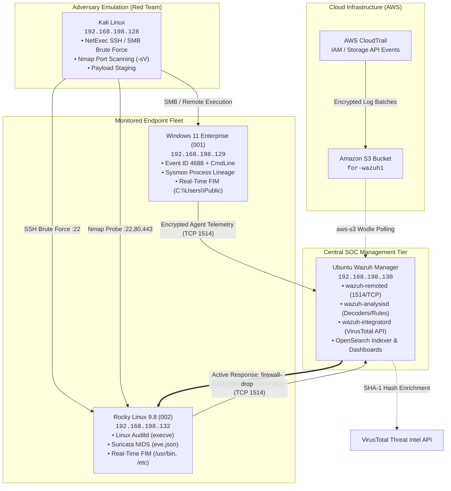

# 🏗️ Hybrid Enterprise SOC Lab Architecture

This directory details the infrastructure specifications, network topology, endpoint hardening, and the root-cause diagnosis of why default SIEM deployments suffer from telemetry blindness.

---

## 1. Enterprise Lab Topology & Node Specifications

The lab mirrors an enterprise defense network comprising central management, dual-OS endpoint victims, cloud infrastructure, and an external adversary node.

```
+---------------------------------------------------------------------------------------------------+
| HYBRID ENTERPRISE SOC LAB TOPOLOGY                                                                |
+---------------------------------------------------------------------------------------------------+
| 1. CENTRAL SIEM MANAGER & DASHBOARD                                                               |
|    - Hostname: ubuntu-bgnr / wazuh-manager                                                        |
|    - OS: Ubuntu 22.04 LTS / 24.04 LTS | IP: 192.168.198.130                                       |
|    - Role: Ingestion (Port 1514), Enrollment (Port 1515), Analysis Engine (wazuh-analysisd),        |
|            OpenSearch Indexer & Dashboards (Port 443/5601), VirusTotal API Integration,           |
|            Active Response Dispatcher                                                             |
|                                                                                                   |
| 2. WINDOWS ENTERPRISE VICTIM (Agent ID: 001)                                                      |
|    - Hostname: windows-vm-01                                                                      |
|    - OS: Windows 11 Enterprise Evaluation (Build 10.0.26200) | IP: 192.168.198.129                |
|    - Agent Version: Wazuh Agent v4.11.2 / v4.14.8                                                 |
|    - Telemetry Stack: Windows Defender Firewall (ON), Sysmon v15 (SwiftOnSecurity Config),       |
|                       Advanced Audit Policy (Process Creation Event 4688 + Command Line Logging), |
|                       Real-Time FIM (C:\Users\Public)                                             |
|                                                                                                   |
| 3. LINUX ENTERPRISE VICTIM (Agent ID: 002)                                                        |
|    - Hostname: rhel-endpoint-01                                                                   |
|    - OS: Rocky Linux 9.8 (RHEL-based) | IP: 192.168.198.132                                       |
|    - Agent Version: Wazuh Agent v4.14.8                                                           |
|    - Telemetry Stack: Firewalld (Active), Linux Auditd (execve & identity tracking),               |
|                       Suricata NIDS (Network eve.json), Real-Time FIM (/etc, /root, /usr/bin)     |
|                                                                                                   |
| 4. ADVERSARY EMULATION NODE (Red Team)                                                            |
|    - Hostname: kali                                                                               |
|    - OS: Kali Linux 2024.x | IP: 192.168.198.128                                                  |
|    - Role: Nmap Reconnaissance, NetExec SMB/SSH Brute Force, Payload Staging,                      |
|            Reverse Shell Execution                                                                |
|                                                                                                   |
| 5. CLOUD INFRASTRUCTURE (AWS CloudTrail)                                                          |
|    - AWS Account: Good_SEC | Region: us-east-1                                                    |
|    - Role: CloudTrail multi-region management logging shipped to S3 bucket `for-wazuh1`           |
|            polled via Wazuh `aws-s3` wodle                                                        |
+---------------------------------------------------------------------------------------------------+
```

---

## 2. Interactive Network Flow Diagram



---

## 3. The Root-Cause Diagnosis: Why Default SIEMs Produce 0 High/Critical Alerts

During baseline testing, aggressive attacks were executed against the endpoints (password spraying, remote execution, file drops), yet the Wazuh dashboard displayed:
* **Critical Alerts:** `0`
* **High Alerts:** `0`
* **Medium Alerts:** `209`
* **Low Alerts:** `1,117`

### The 4 Visibility Gaps

```
+-------------------------------------------------------------------------------------------------+
| Wazuh Rule Severity Hierarchy                                                                   |
+-------------------------------------------------------------------------------------------------+
| Level 00 - 06 : Low         (Routine system noise, single failed logons)                        |
| Level 07 - 11 : Medium      (Repeated failures, sudo execution, config drift)                   |
| Level 12 - 14 : High        (Account lockouts, verified attack tools, confirmed brute force)    |
| Level 15 - 16 : Critical    (Active exploits, C2 reverse shells, malware execution, ransomware) |
+-------------------------------------------------------------------------------------------------+
```

1. **Windows Auditing Blindness:** Out-of-the-box Windows does not log command-line execution (Event ID `4688` command-line logging is disabled by default in the registry). A single failed logon generates Event ID `4625`, which maps to Rule `60122` (**Level 5 - Low**). Without an account lockout threshold, it never escalates to High severity.
2. **Missing Process Telemetry (No Sysmon):** Default Windows logs cannot trace parent-child process lineage (e.g., `services.exe` $\rightarrow$ `svchost.exe` or `WmiPrvSE.exe` spawning `cmd.exe`).
3. **Scheduled vs. Real-Time FIM:** Wazuh's default `<syscheck>` frequency is 12 hours (`<frequency>43200</frequency>`). Dropped payloads are not inspected immediately, and an unclassified file addition triggers only Rule `554` (**Level 5 - Low**).
4. **Zero Threat Intelligence Enrichment:** Without an automated reputation lookup engine (such as `wazuh-integratord` querying VirusTotal), a dropped malware sample is treated as an arbitrary neutral file.

---

## 4. Architectural Hardening Applied

To eliminate these blind spots, the following core configurations were deployed:
* **Windows 11:** Enabled process command-line inclusion (`ProcessCreationIncludeCmdLine_Enabled = 1`), enabled Sysmon 64 logging, enabled Windows Firewall across all profiles with explicit administration ports, and configured real-time FIM on `C:\Users\Public`.
* **Rocky Linux 9:** Configured `firewalld` with strict zones, deployed `auditd` rules monitoring `execve` system calls and `/etc/shadow`, routed Suricata `eve.json` into Wazuh, and enabled real-time differential FIM across `/etc`, `/usr/bin`, and `/root`.
* **Ubuntu Manager:** Configured VirusTotal API integration, connected AWS CloudTrail via IAM minimum privilege S3 polling, authored custom PCRE2 detection rules, and configured Active Response automated drop actions.
