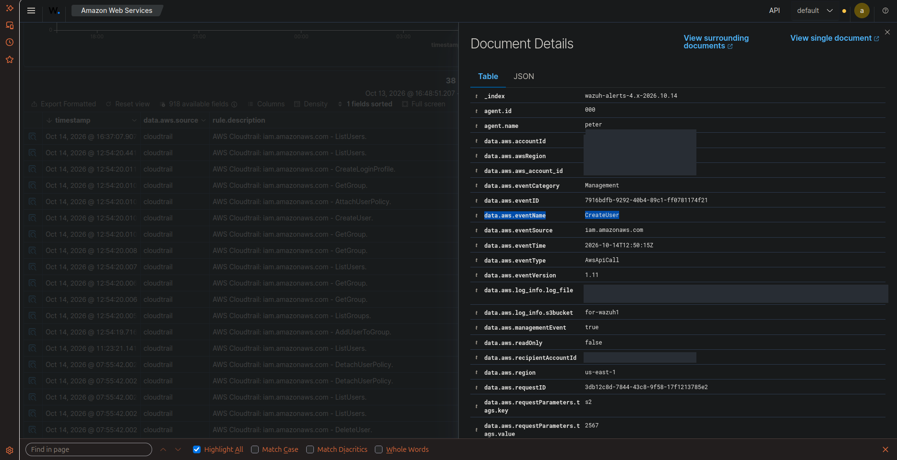
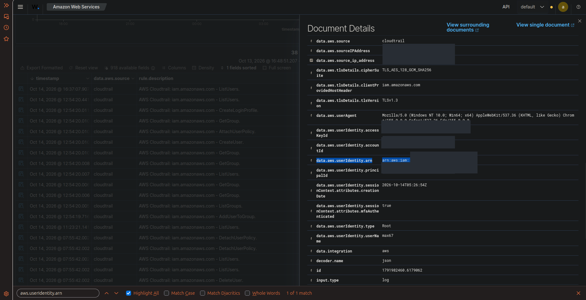
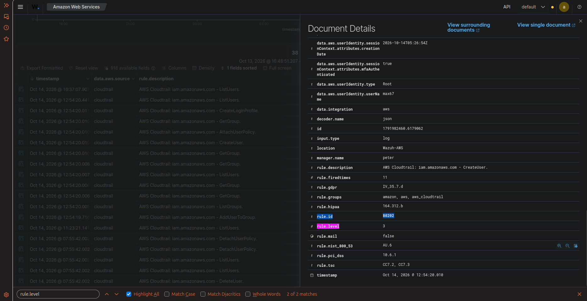

# 🛡️ Task 01: Cloud Identity & Access Audit (AWS CloudTrail)

## 📌 Challenge Overview

| Attribute | Specification |
| :--- | :--- |
| **Domain** | Cloud SIEM & Identity Governance (CSPM) |
| **Target Infrastructure** | AWS Cloud (`Good_SEC` \| Account ID: `4558********` \| Region: `us-east-1`) |
| **Log Delivery Pipeline** | AWS CloudTrail $\rightarrow$ Amazon S3 (`for-wazuh1`) $\rightarrow$ Wazuh `aws-s3` Wodle |
| **Triggered Alert** | **Rule `80202` (Level 3 - Informational / Audit)** |
| **MITRE ATT&CK Mapping** | **T1136.003** (Cloud Account Creation), **T1078.004** (Cloud Accounts) |
| **Verification Status** | **Verified in Live Lab** |

---

## 🎯 The Mission Scenario

An adversary or rogue insider with access to root or administrative cloud credentials performs unauthorized identity operations in the company's AWS production environment. 

The SOC Lead requires proof that:
1. An administrative IAM action executed in the AWS Management Console is successfully logged by CloudTrail.
2. Encrypted log batches stored in Amazon S3 bucket `for-wazuh1` are polled and ingested by the Wazuh Manager's `aws-s3` module.
3. The exact event name, actor identity ARN, and triggered Wazuh Rule ID are correctly indexed in the OpenSearch database.

---

## ⚙️ Technical Implementation & Pipeline Flow

### 1. AWS IAM & S3 Ingestion Configuration
The Wazuh Manager polls CloudTrail logs stored in S3 via the `aws-s3` wodle configured in `/var/ossec/etc/ossec.conf`:

```xml
<wodle name="aws-s3">
  <disabled>no</disabled>
  <interval>5m</interval>
  <run_on_start>yes</run_on_start>
  <service type="cloudtrail">
    <bucket name="for-wazuh1">
      <aws_profile>default</aws_profile>
    </bucket>
  </service>
</wodle>
```

### 2. Adversary Action Emulated
- Authenticated to the AWS Management Console using root credentials.
- Navigated to **IAM (Identity and Access Management)**.
- Executed user provisioning action: created a new IAM user (`CreateUser` API call).

---

## 🔍 Verified Investigation Deliverables

### Raw OpenSearch Event Fields Extracted:
* **Event Name (`data.aws.eventName`):** `CreateUser`
* **Actor ARN (`data.aws.userIdentity.arn`):** `arn:aws:iam::4558********:root`
* **Actor User Name (`data.aws.userIdentity.userName`):** `max67`
* **Account ID (`data.aws.accountId`):** `4558********`
* **Event Source (`data.aws.eventSource`):** `iam.amazonaws.com`
* **Source IP Address (`data.aws.sourceIPAddress`):** Redacted for OPSEC (`XXX.XXX.XXX.XXX`)
* **Wazuh Rule ID (`rule.id`):** `80202`
* **Wazuh Rule Level (`rule.level`):** `3`
* **Rule Description:** `AWS CloudTrail: iam.amazonaws.com - CreateUser.`

---

## 📸 Verified Technical Evidence

### 1. CloudTrail Event Details in Wazuh WUI
Shows raw JSON event fields indexed into `wazuh-alerts-4.x-*`:



### 2. User Identity & Access Audit Verification
Confirms root caller identity ARN and API caller credentials:



### 3. Rule ID 80202 Trigger Verification
Confirms Rule `80202` Level 3 execution:



---

## 🧠 Analyst Engineering Notes & Lessons Learned

> **SOC Analyst Insight:**  
> CloudTrail introduces an inherent delivery latency (typically 5–15 minutes) before events are written to S3 and flushed to external SIEM connectors. Understanding this ingestion window is critical during active cloud incident triage—an analyst must never assume lack of alerts means lack of activity until the S3 delivery window has elapsed.
