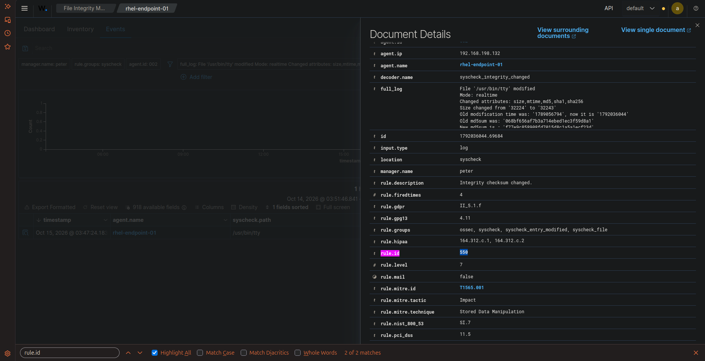
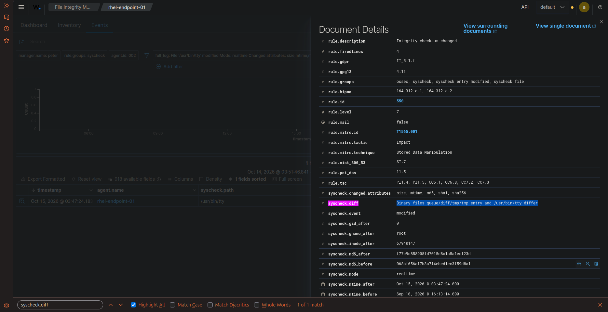

# 🛡️ Task 02: Real-Time FIM & Differential Analysis (The Defaced File)

## 📌 Challenge Overview

| Attribute | Specification |
| :--- | :--- |
| **Domain** | Host Security, File Integrity Monitoring (FIM) & Integrity Auditing |
| **Target Host** | Rocky Linux 9.8 (`rhel-endpoint-01` - `192.168.198.132` \| Agent ID: `002`) |
| **Target File** | `/usr/bin/tty` (Linux System Binary) |
| **Triggered Alert** | **Rule `550` (Level 7 - Medium / Integrity Checksum Changed)** |
| **MITRE ATT&CK Mapping** | **T1565.001** (Stored Data Manipulation) |
| **Verification Status** | **Verified in Live Lab** |

---

## 🎯 The Mission Scenario

An adversary gains privileged access to an enterprise server and defaces or backdoors a system file. 

The SOC Lead requires proof that:
1. Wazuh's inotify real-time engine (`realtime="yes"`, `report_changes="yes"`) detects unauthorized modifications instantly without waiting for a scheduled 12-hour scan.
2. The exact differential changes (`syscheck.diff`) between the original and modified file are captured.
3. Cryptographic hashes (MD5, SHA1, SHA256) and attribute changes (size, mtime, inode) are recorded into the security event.

---

## ⚙️ Technical Implementation & Configuration

### 1. Real-Time FIM Configuration
In Rocky Linux `/var/ossec/etc/ossec.conf`, the `<syscheck>` block was hardened:

```xml
<syscheck>
  <disabled>no</disabled>
  <frequency>43200</frequency>
  
  <!-- Real-time monitoring with differential recording -->
  <directories check_all="yes" realtime="yes" report_changes="yes">/etc,/usr/bin,/usr/sbin,/root</directories>
  <directories check_all="yes" realtime="yes">/bin,/sbin,/boot</directories>
</syscheck>
```

Restarted the agent service:
```bash
sudo systemctl restart wazuh-agent
```

### 2. The Adversary Emulation Experiment
Rather than simply modifying an arbitrary `.txt` file, an authentic security researcher experiment was conducted: **tampering with a live compiled system binary** (`/usr/bin/tty`).

```bash
# Appended byte sequence to test inotify binary handling
echo -e "\n# DEFACED_BY_ADVERSARY" >> /usr/bin/tty
```

---

## 🔍 Verified Investigation Deliverables

### Raw Event Attributes & Cryptographic Hashes:
* **Target File Path (`syscheck.path`):** `/usr/bin/tty`
* **Triggered Rule ID (`rule.id`):** `550`
* **Rule Level (`rule.level`):** `7`
* **Rule Description:** `Integrity checksum changed.`
* **Monitoring Mode (`syscheck.mode`):** `realtime`
* **Changed Attributes (`syscheck.changed_attributes`):** `size, mtime, md5, sha1, sha256`
* **Size Difference:** Changed from `32224` to `32243` bytes (+19 bytes)
* **Pre-tampering MD5 (`syscheck.md5_before`):** `068bf656af7b3a714ebed1ec3f59d8a1`
* **Post-tampering MD5 (`syscheck.md5_after`):** `f77e9c858908fd7015d8c1a5a1ecf23d`
* **Differential Output (`syscheck.diff`):**  
  `Binary files queue/diff/tmp/tmp-entry and /usr/bin/tty differ`

---

## 📸 Verified Technical Evidence

### 1. Sub-Second Real-Time FIM Alert in Wazuh WUI
Shows Rule `550` firing on `rhel-endpoint-01` with full cryptographic attribute changes:



### 2. Differential Analysis (`syscheck.diff`)
Demonstrates Wazuh's diff engine comparing baseline cache against the tampered binary:



---

## 🧠 Analyst Engineering Notes & Lessons Learned

> **Analyst Insight & Lessons Learned:**  
> *"I know it's not a text file, but I wanted to see what happens if I do it to a binary file and save it."*
>
> **SOC Takeaway:**  
> When modifying text files (`.conf`, `.sh`, `.xml`), Wazuh includes a line-by-line unified diff showing exactly what lines were inserted or deleted. For binary files (`ELF` / `PE`), Wazuh safely flags that binary structures differ without bloating the OpenSearch index with raw compiled binary bytes.
