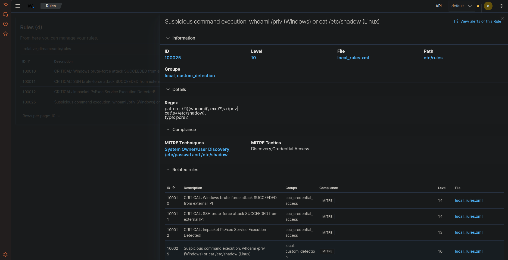
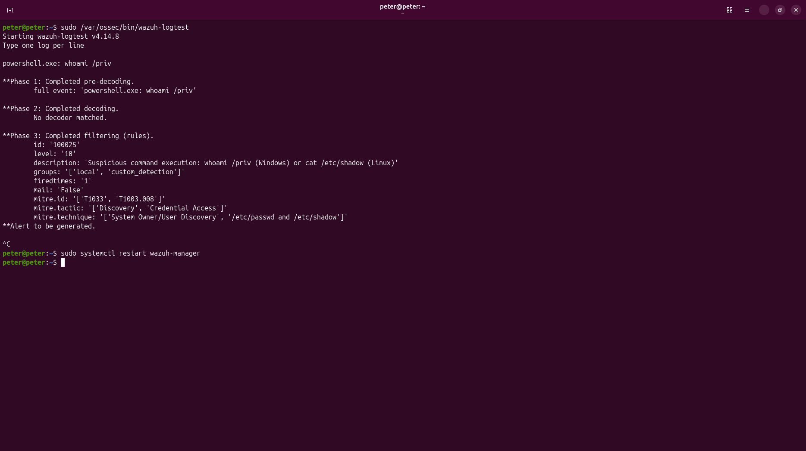

# 🛡️ Task 03: Detection Engineering (Custom Rule from Scratch)

## 📌 Challenge Overview

| Attribute | Specification |
| :--- | :--- |
| **Domain** | Detection Engineering, PCRE2 Regex, MITRE ATT&CK Mapping |
| **Target Engine** | Ubuntu Wazuh Manager (`192.168.198.130` \| Wazuh v4.14.8) |
| **Rule Specification** | Rule ID `100025`, Severity Level `10` |
| **Detection Scope** | `whoami /priv` (Windows Privilege Discovery) OR `cat /etc/shadow` (Linux Credential Access) |
| **MITRE ATT&CK Mapping** | **T1033** (System Owner/User Discovery), **T1003.008** (/etc/passwd and /etc/shadow) |
| **Verification Status** | **Verified in Live Lab** |

---

## 🎯 The Mission Scenario

Default out-of-the-box SIEM rulesets frequently miss local reconnaissance and privilege discovery commands because single administrative inquiries look benign without contextual elevation.

The SOC Lead requires:
1. Authoring a custom detection rule in `/var/ossec/etc/rules/local_rules.xml` with **ID `100025`** and **Level `10`**.
2. Using case-insensitive, optimized **PCRE2 regex** matching both Windows (`whoami /priv` / `whoami.exe /priv`) and Linux (`cat /etc/shadow`).
3. Mapping the rule to its official MITRE ATT&CK tactic and technique IDs.
4. Testing and verifying the rule offline in the CLI using `/var/ossec/bin/wazuh-logtest` showing Phase 1, Phase 2, and Phase 3 validation before restarting the manager daemon.

---

## ⚙️ Technical Implementation & Rule Definition

### 1. XML Rule Definition
Authored inside `/var/ossec/etc/rules/local_rules.xml`:

```xml
<group name="local,custom_detection,">
  <rule id="100025" level="10">
    <description>Suspicious command execution: whoami /priv (Windows) or cat /etc/shadow (Linux)</description>
    <regex type="pcre2">(?i)(whoami(\.exe)?\s+/priv|cat\s+/etc/shadow)</regex>
    <mitre>
      <id>T1033</id>
      <id>T1003.008</id>
    </mitre>
  </rule>
</group>
```

### 2. PCRE2 Regex Pattern Analysis
* `(?i)`: Case-insensitive modifier (matches `WHOAMI /PRIV`, `whoami /priv`, `Cat /Etc/Shadow`).
* `whoami(\.exe)?`: Matches both modern PowerShell / CMD interactive calls and explicit binary invocations (`whoami.exe`).
* `\s+/priv`: Accommodates variable whitespace before the privilege flag.
* `|cat\s+/etc/shadow`: Logical OR matching attempts to dump the Linux credential database.

---

## 🔍 Validation via `wazuh-logtest`

Executed directly on the Ubuntu Manager:
```bash
sudo /var/ossec/bin/wazuh-logtest
```

Input provided:
```text
powershell.exe: whoami /priv
```

### CLI Execution Output:
```text
Starting wazuh-logtest v4.14.8
Type one log per line

powershell.exe: whoami /priv

**Phase 1: Completed pre-decoding.
	full event: 'powershell.exe: whoami /priv'

**Phase 2: Completed decoding.
	No decoder matched.

**Phase 3: Completed filtering (rules).
	id: '100025'
	level: '10'
	description: 'Suspicious command execution: whoami /priv (Windows) or cat /etc/shadow (Linux)'
	groups: '['local', 'custom_detection']'
	firedtimes: '1'
	mail: 'False'
	mitre.id: '['T1033', 'T1003.008']'
	mitre.tactic: '['Discovery', 'Credential Access']'
	mitre.technique: '['System Owner/User Discovery', '/etc/passwd and /etc/shadow']'
**Alert to be generated.
```

Following successful validation, restarted the manager daemon:
```bash
sudo systemctl restart wazuh-manager
```

---

## 📸 Verified Technical Evidence

### 1. Custom Rule Definition in Wazuh WUI
Shows Rule `100025` registered with Level 10, PCRE2 regex, and mapped MITRE techniques:



### 2. Live CLI `wazuh-logtest` Phase 3 Match
Proves the analysis engine matches the rule, assigns Level 10, and generates an alert:



---

## 🧠 Analyst Engineering Notes & Lessons Learned

> **SOC Engineering Best Practice: Decoder Matching & Rule Scoping**
>
> In the live offline test via `wazuh-logtest`:
> ```text
> **Phase 2: Completed decoding.
> 	No decoder matched.
> **Phase 3: Completed filtering (rules).
> 	id: '100025'
> ```
> **Why did Rule 100025 match even when `No decoder matched`?**  
> Rule `100025` was authored with a top-level `<regex>` tag without an `<if_group>` or `<if_sid>` constraint. When no specific pre-decoder or decoder extracts structured XML/JSON fields, Wazuh's analysis engine (`wazuh-analysisd`) evaluates unanchored regexes directly against the raw event payload string (`full event`). While this allows rapid prototyping and multi-platform testing (`whoami /priv` and `cat /etc/shadow` in a single rule), running unanchored top-level regexes across all fleet logs in an enterprise production SOC causes significant CPU overhead.
>
> **Production Scoping Implementation:**  
> In high-throughput production environments, detection rules should be explicitly scoped to parsed fields:
> 1. **Windows EventChannel Telemetry:** Scope under `<if_group>windows</if_group>` and target `<field name="win.eventdata.commandLine">`:
>    ```xml
>    <rule id="100026" level="10">
>      <if_group>windows</if_group>
>      <field name="win.eventdata.commandLine" type="pcre2">(?i)whoami(\b|\.exe)?\s+/priv</field>
>      <description>Windows Privilege Discovery: whoami /priv</description>
>      <mitre><id>T1033</id></mitre>
>    </rule>
>    ```
> 2. **Linux Auditd / Syslog Telemetry:** Scope under `<if_group>auditd</if_group>` or syslog command execution:
>    ```xml
>    <rule id="100027" level="10">
>      <if_group>auditd</if_group>
>      <field name="audit.command" type="pcre2">cat|shadow</field>
>      <description>Linux Credential Access: Reading /etc/shadow</description>
>      <mitre><id>T1003.008</id></mitre>
>    </rule>
>    ```
>
> Never restart `wazuh-manager` without first testing new rules through `wazuh-logtest`. An unclosed XML tag or invalid regex syntax will crash `wazuh-analysisd`, silently halting all log ingestion across the enterprise fleet.