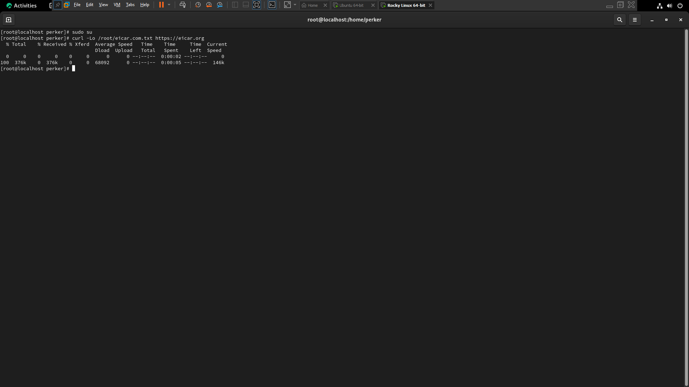
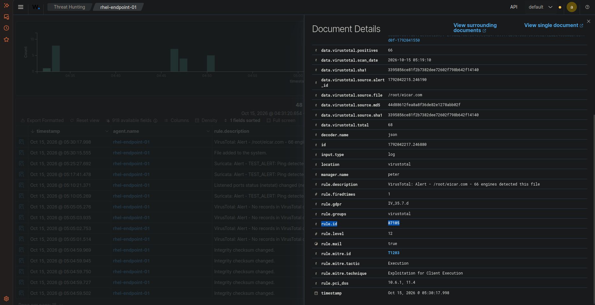
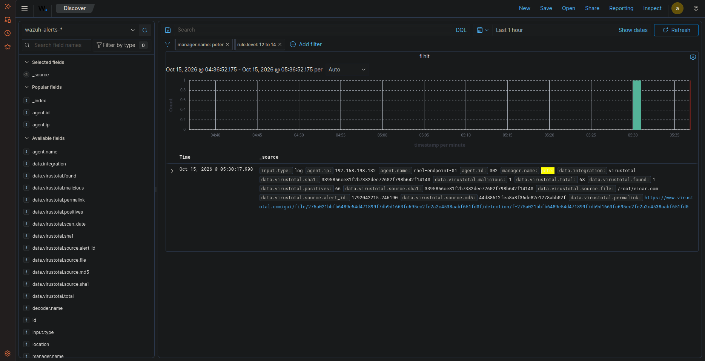

# 🛡️ Task 04: Threat Intelligence Enrichment (VirusTotal in the Wild)

## 📌 Challenge Overview

| Attribute | Specification |
| :--- | :--- |
| **Domain** | Threat Intelligence Integration & Automated Hash Reputation |
| **Target Host** | Rocky Linux 9.8 (`rhel-endpoint-01` \| Agent ID: `002`) + Ubuntu Manager |
| **Integration Daemon** | `wazuh-integratord` $\rightarrow$ VirusTotal Public/Enterprise API |
| **Triggered Alert** | **Rule `87105` (Level 12 - High / VirusTotal Engine Alert)** |
| **Payload Used** | Standard EICAR Antivirus Test String (`eicar.com`) |
| **MITRE ATT&CK Mapping** | **T1203** (Exploitation for Client Execution) |
| **Verification Status** | **Verified in Live Lab** |

---

## 🎯 The Mission Scenario

When an adversary drops an executable payload onto an enterprise server, standard log ingestion treats the file addition as neutral (Rule `554`, Level 5). The SOC requires automated reputation scoring to instantly escalate known malicious binaries to Tier 2/3 analysts.

The SOC Lead requires:
1. Configuring the Wazuh Manager's `wazuh-integratord` daemon with a valid VirusTotal API key.
2. Dropping the standard EICAR test string into a directory monitored by real-time FIM on Rocky Linux.
3. Allowing the FIM engine to compute file hashes (MD5, SHA-1, SHA-256) and forward them to VirusTotal via API.
4. Extracting the positive detection ratio, SHA-1 cryptographic hash, and triggered Rule ID from the enriched OpenSearch document.

---

## ⚙️ Technical Implementation & Configuration

### 1. Manager VirusTotal Integration
Configured in Ubuntu Manager `/var/ossec/etc/ossec.conf` immediately before `</ossec_config>`:

```xml
<!-- VirusTotal Threat Intelligence Integration -->
<integration>
  <name>virustotal</name>
  <api_key><YOUR_VIRUSTOTAL_API_KEY></api_key>
  <group>syscheck</group>
  <alert_format>json</alert_format>
</integration>
```

Restarted the manager daemon:
```bash
sudo systemctl restart wazuh-manager
```

### 2. Dropping the EICAR Test Payload
On Rocky Linux 9.8 (`192.168.198.132`), downloaded the EICAR test payload into `/root/`:

```bash
sudo su
curl -Lo /root/eicar.com.txt https://eicar.org
```

---

## 🔍 Verified Investigation Deliverables

### Raw OpenSearch Document Attributes:
* **Target File Path (`data.virustotal.source.file`):** `/root/eicar.com`
* **Cryptographic SHA-1 (`data.virustotal.source.sha1`):** `3395856ce81f2b7382dee72602f798b642f14140`
* **Cryptographic MD5 (`data.virustotal.source.md5`):** `44d88612fea8a8f36de82e1278abb02f`
* **Positive Engine Detections (`data.virustotal.positives`):** **66**
* **Total Antivirus Engines Scanned (`data.virustotal.total`):** **68**
* **Triggered Wazuh Rule ID (`rule.id`):** `87105`
* **Rule Level (`rule.level`):** **12 (High)**
* **Rule Description:** `VirusTotal: Alert - /root/eicar.com - 66 engines detected this file`
* **VirusTotal Permalink:** Recorded in `data.virustotal.permalink` linking directly to GUI report.

---

## 📸 Verified Technical Evidence

### 1. EICAR Test Payload Dropped via CLI
Terminal output on Rocky Linux downloading the test signature:



### 2. Enriched VirusTotal Alert Details in Wazuh WUI
Threat Hunting document showing 66/68 positive engines, Rule `87105`, and SHA-1 hash:



### 3. OpenSearch Discover High-Severity Triage
Discover event showing Level 12 escalation within seconds of the file drop:



---

## 🧠 Analyst Engineering Notes & Lessons Learned

> **SOC Privacy & Bandwidth Architecture:**  
> Wazuh's VirusTotal integration never uploads the raw file payload to VirusTotal servers. It calculates hashes locally on the endpoint, transmits only the 40-character SHA-1 / 64-character SHA-256 hash across the API, and receives the threat intelligence verdict. This preserves proprietary customer code while defending against malicious payloads.
