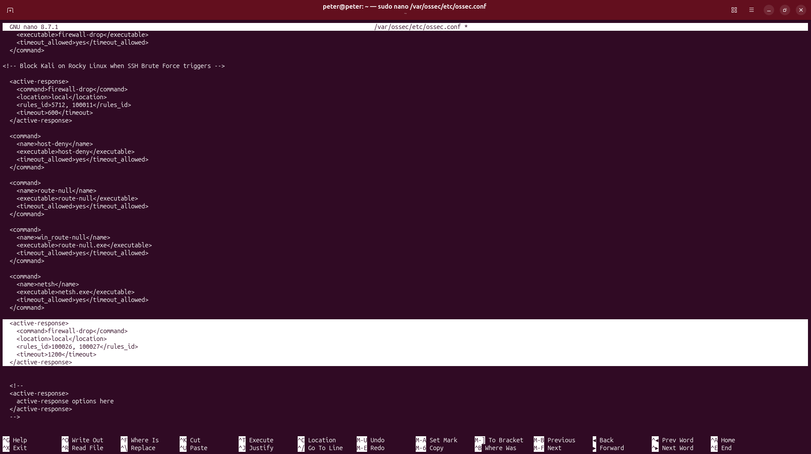
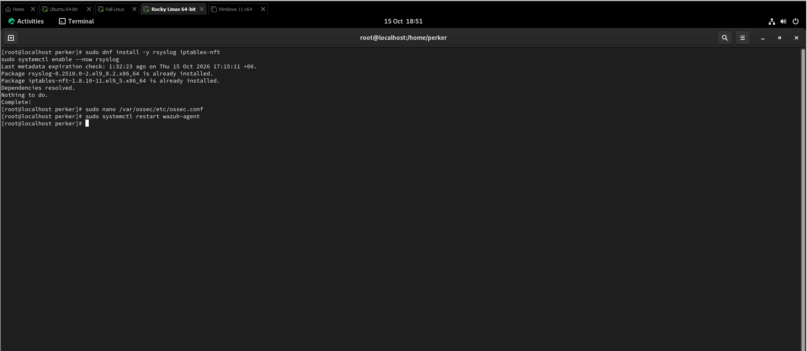
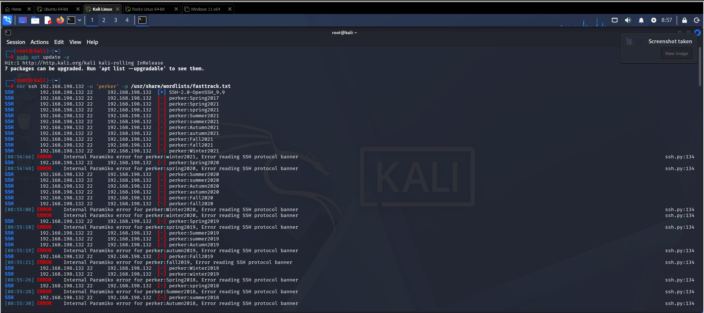
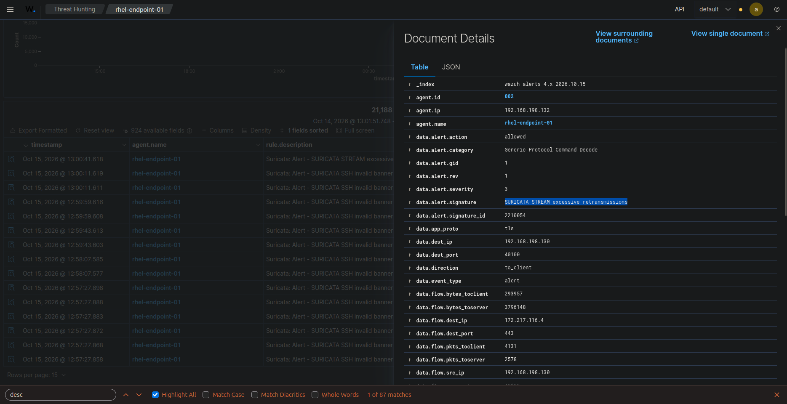

# 🛡️ Task 05: Active Defense Verification (Automated IP Blocking)

## 📌 Challenge Overview

| Attribute | Specification |
| :--- | :--- |
| **Domain** | Active Response, Dynamic Host Firewalling & Incident Containment |
| **Target Host** | Rocky Linux 9.8 (`192.168.198.132` \| Agent ID: `002`) |
| **Adversary Machine** | Kali Linux (`192.168.198.128`) |
| **Attack Vector** | High-Rate SSH Credential Brute-Force via NetExec (`nxc`) |
| **Containment Action** | Dynamic Firewall Drop (`firewall-drop` script) |
| **Triggered Rules** | **Rule `5712` / `100011`** |
| **MITRE ATT&CK Mapping** | **T1110** (Brute Force), **T1078** (Valid Accounts) |
| **Verification Status** | **Verified in Live Lab** |

---

## 🎯 The Mission Scenario

An external attacker from Kali Linux initiates an automated SSH brute-force attack against an enterprise Linux server.

The SOC Lead requires:
1. Simulating an authentication brute-force attack from Kali using NetExec (`nxc`) with a wordlist of incorrect credentials.
2. Configuring Wazuh Active Response on the Manager to automatically trigger `firewall-drop` upon detecting repeated authentication failures.
3. Verifying that the attacker's network connection is severed in real-time, locking out the attacking IP address.

---

## ⚙️ Technical Implementation & The 5-Hour Troubleshooting Battle

This challenge proved to be one of the most intense, authentic engineering learning experiences in the entire gauntlet. I spent 5 continuous hours diagnosing every moving part of the Linux host defense pipeline.

### 1. The Linux Endpoint Hardening
Rocky Linux 9 defaults to modern `nftables` and `systemd-journald` without traditional syslog files. The following steps were executed:
```bash
# Installed rsyslog and iptables-nft translation layer
sudo dnf install -y rsyslog iptables-nft
sudo systemctl enable --now rsyslog

# Started firewalld host firewall service
sudo systemctl enable --now firewalld
```

Monitored `/var/log/secure` as a syslog source in Rocky Linux's `/var/ossec/etc/ossec.conf`:
```xml
<localfile>
  <log_format>syslog</log_format>
  <location>/var/log/secure</location>
</localfile>
```

### 2. Wazuh Manager Active Response Configuration
In `/var/ossec/etc/ossec.conf` on the Ubuntu Manager:
```xml
<!-- Dynamic Active Response: Drop Kali upon SSH Brute Force -->
<active-response>
  <command>firewall-drop</command>
  <location>defined-agent</location>
  <agent_id>002</agent_id>
  <rules_id>5712, 100011</rules_id>
  <timeout>1200</timeout>
</active-response>
```

### 3. Adversary Attack Execution from Kali Linux
From Kali Linux (`192.168.198.128`), launched NetExec against Rocky Linux:
```bash
nxc ssh 192.168.198.132 -u 'perker' -p /usr/share/wordlists/fasttrack.txt
```

---

## 🔍 Verified Investigation Deliverables

### The Moment of Containment:
As the brute-force attack crossed the alert threshold, NetExec experienced catastrophic connection drops:
```text
[08:54:46] ERROR Internal Paramiko error for perker:winter2021, Error reading SSH protocol banner
[08:54:48] ERROR Internal Paramiko error for perker:spring2020, Error reading SSH protocol banner
[08:54:50] ERROR Internal Paramiko error for perker:Summer2020, Error reading SSH protocol banner
```
The SSH daemon stopped responding to Kali because incoming packets were dropped at the kernel firewall layer!

---

## 📸 Verified Technical Evidence

### 1. Active Response Configuration in Manager `ossec.conf`
Shows `firewall-drop` configuration with rule triggers and timeouts:



### 2. Rocky Linux `iptables-nft` & `rsyslog` Deployment
Shows package installation and daemon enablement on the victim host:



### 3. Kali Linux NetExec Connection Drop
NetExec Paramiko errors confirming network drop during active password spraying:



### 4. Suricata SSH Protocol Decoding
Wazuh dashboard showing Suricata flagging SSH protocol anomalies during the drop:



---

## 🧠 Analyst Engineering Notes & The Crucial Nuance

> **The Senior SOC Nuance: `<location>` Target Logic:**  
> During initial deployment testing, the active response was configured with `<location>local</location>`. However, this failed to drop Kali's packets at the victim endpoint.  
> 
> The microscopic architectural detail:  
> * `<location>local</location>` tells the system to execute the script **on the machine that generated the alert** (the Manager itself). It does not block traffic reaching Agent 002.
> * `<location>defined-agent</location>` with `<agent_id>002</agent_id>` (or `<location>all</location>`) commands the Manager to dispatch the AR execution command over `TCP 1514` to **Agent 002 (Rocky Linux)** so that Rocky drops Kali's packets in its local firewall.
>
> Diagnosing and resolving this interaction provided deep, practical infrastructure knowledge of Wazuh's distributed command-and-control messaging bus.
