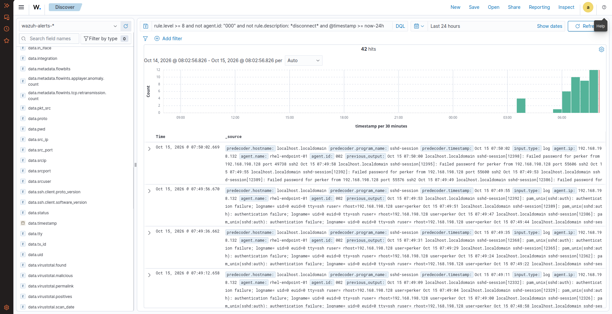
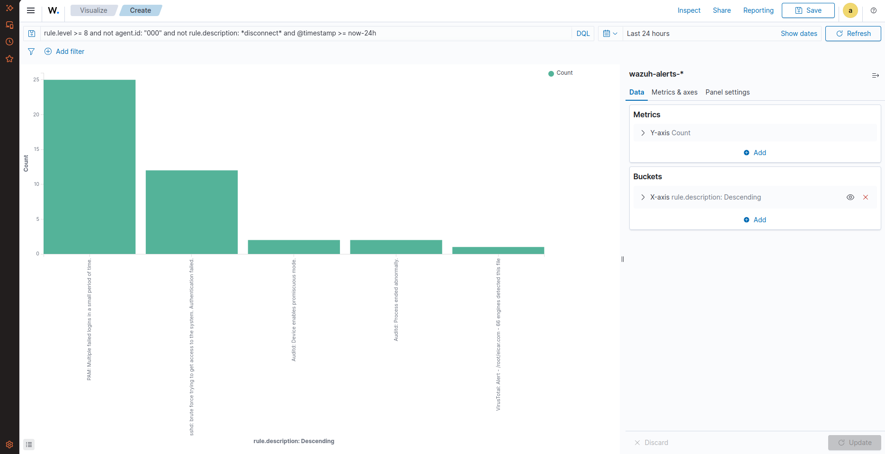
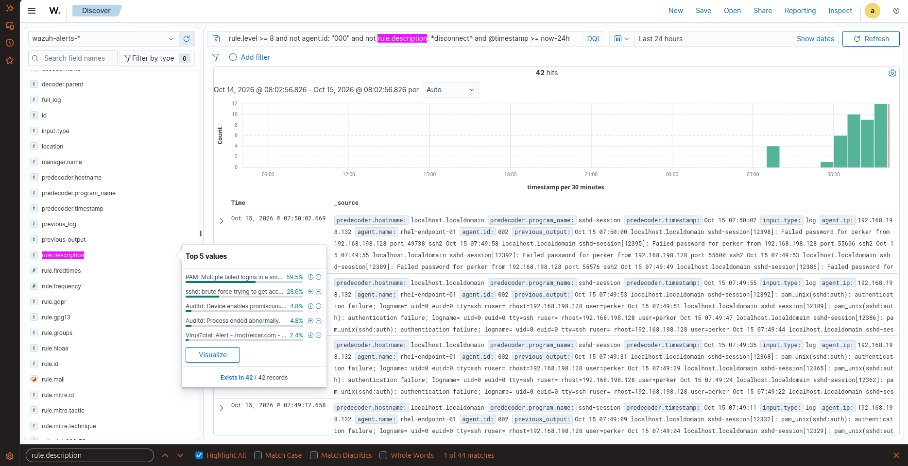

# 🛡️ Task 06: The SOC Threat Hunter (DQL Query Crafting & Aggregation)

## 📌 Challenge Overview

| Attribute | Specification |
| :--- | :--- |
| **Domain** | Threat Hunting, Dashboard Query Language (DQL), Alert Noise Filtering |
| **Target Engine** | OpenSearch Dashboards (Wazuh WUI Discover & Visualize) |
| **Query Constraints** | Severity Level $\ge 8$, Exclude Manager (`000`), Exclude SSH Disconnect noise, Past 24 Hours |
| **Query Hits Returned** | **42 Exact Incidents** |
| **MITRE ATT&CK Mapping** | **T1110** (Brute Force), **T1078** (Valid Accounts) |
| **Verification Status** | **Verified in Live Lab** |

---

## 🎯 The Mission Scenario

During an active incident, SOC analysts face severe alert fatigue caused by heartbeat events, automated manager disconnects, and low-level noise.

The SOC Lead requires:
1. Crafting a single, targeted OpenSearch / DQL query string that:
   - Filters alerts with Rule Level $\ge 8$ (High to Critical).
   - Filters out all manager internal telemetry (`not agent.id: "000"`).
   - Eliminates routine network disconnect spam (`not rule.description: *disconnect*`).
   - Scopes precisely to the last 24 hours (`@timestamp >= now-24h`).
2. Isolating the exact hit count and top threat distributions.
3. Building a custom visualization chart to report high-risk events to leadership.

---

## ⚙️ Technical Implementation & The DQL Query

### The Exact DQL Query String
Authored and executed directly inside the **Wazuh Discover** query bar:

```sql
rule.level >= 8 and not agent.id: "000" and not rule.description: *disconnect* and @timestamp >= now-24h
```

---

## 🔍 Verified Investigation Deliverables

### 1. Total Threat Hunting Hits:
* **Hits Returned:** **42 exact records** cleanly isolated from background fleet telemetry.

### 2. Top Threat Distribution Breakdown:
* **`PAM: Multiple failed logins in a small period of time.`** — **59.5%** (~25 hits)
* **`sshd: brute force trying to get access to the system. Authentication failed.`** — **28.6%** (~12 hits)
* **`Auditd: Device enables promiscuous mode.`** — **4.8%** (2 hits)
* **`Auditd: Process ended abnormally.`** — **4.8%** (2 hits)
* **`VirusTotal: Alert - /root/eicar.com - 66 engines detected this file`** — **2.4%** (1 hit)

---

## 📸 Verified Technical Evidence

### 1. OpenSearch Discover Triage (42 Hits)
Shows the query filtering out manager noise and displaying endpoint authentication failures:



### 2. Custom Aggregation Bar Chart
Custom horizontal visualization created during investigation displaying descending rule frequency:



### 3. Discover Field Value Distribution Popup
Direct proof of the top 5 values and percentage breakdown:



---

## 🧠 Analyst Engineering Notes & Lessons Learned

> **SOC Triage Best Practice:**  
> Relying only on visual GUI filters wastes critical minutes during a live breach. Mastering boolean DQL syntax (`and`, `not`, wildcard `*`, range `>=`) allows an analyst to slice through hundreds of thousands of events in milliseconds, isolating the actual attacker trajectory.
