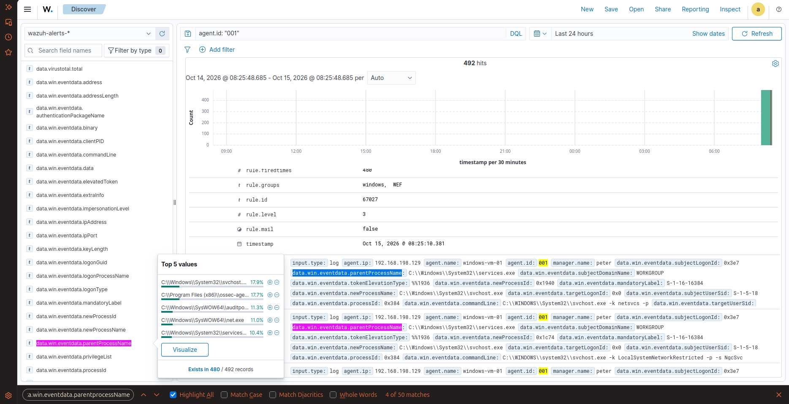
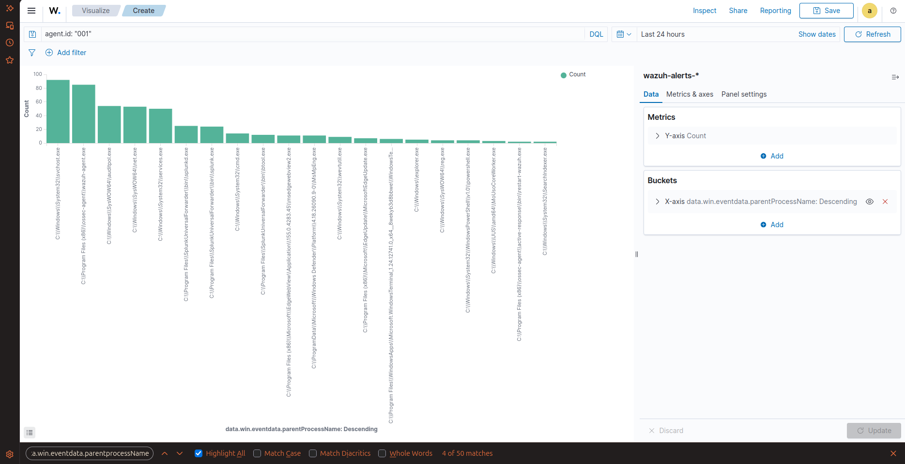
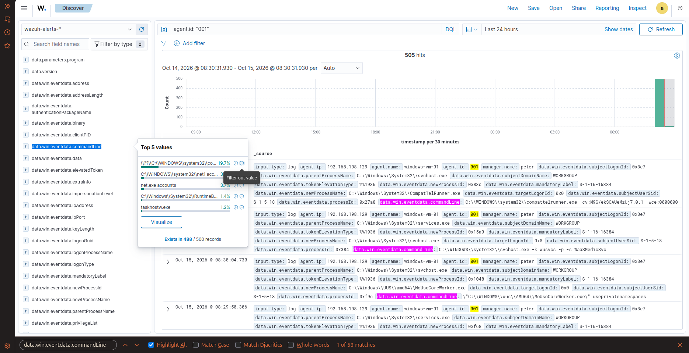
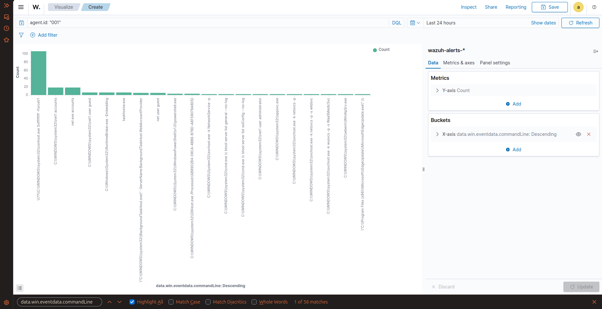

# 🛡️ Task 07: Deep Telemetry Correlation (Windows Process Lineage)

## 📌 Challenge Overview

| Attribute | Specification |
| :--- | :--- |
| **Domain** | Windows Process Forensics, LOLBins & Telemetry Lineage |
| **Target Host** | Windows 11 Enterprise (`windows-vm-01` - `192.168.198.129` \| Agent ID: `001`) |
| **Telemetry Sources** | Advanced Audit Policy (Event ID 4688) & Microsoft Sysmon (Event ID 1) |
| **Triggered Alert** | **Rule `67027` (Level 3 - Process Creation Event)** |
| **Analyzed Lineage** | `services.exe` $\rightarrow$ `svchost.exe -k netsvcs -p` (Benign Baseline Telemetry) |
| **MITRE ATT&CK Mapping** | **T1059.003** (Command Interpreter), **T1036.005** (Masquerading Baseline Analysis) |
| **Verification Status** | **Verified in Live Lab** |

---

## 🎯 The Mission Scenario

Adversaries routinely execute native Windows binaries (LOLBins) such as `powershell.exe`, `net.exe`, or `certutil.exe` to blend in with normal administrative activity.

The SOC Lead requires:
1. Executing interactive processes on Windows 11.
2. In the Wazuh Dashboard, capturing the detailed process creation event.
3. Identifying the exact `parentProcessName`, `newProcessName`, and executed `commandLine` string.
4. Analyzing the critical difference between native Windows Security logging (Event ID 4688) and Sysmon telemetry (Event ID 1).

---

## ⚙️ Technical Implementation & Audit Configuration

### 1. Windows Audit Policy & Command-Line Inclusion
Executed in Administrator PowerShell on Windows 11:
```powershell
# Enable detailed Process Creation auditing
auditpol /set /subcategory:"Process Creation" /success:enable /failure:enable

# Enable command-line argument logging in Event ID 4688 via Registry
New-ItemProperty -Path "HKLM:\SOFTWARE\Microsoft\Windows\CurrentVersion\Policies\System\Audit" `
  -Name "ProcessCreationIncludeCmdLine_Enabled" -Value "1" -PropertyType DWord -Force
```

### 2. Sysmon Channel Ingestion
Ensured Sysmon was forwarded via `C:\Program Files (x86)\ossec-agent\ossec.conf`:
```xml
<localfile>
  <location>Microsoft-Windows-Sysmon/Operational</location>
  <log_format>eventchannel</log_format>
</localfile>
```

---

## 🔍 Verified Investigation Deliverables

### 1. Extracted Process Lineage Fields:
* **Parent Process Name (`data.win.eventdata.parentProcessName`):**  
  `C:\Windows\System32\services.exe`
* **New Process Name (`data.win.eventdata.newProcessName`):**  
  `C:\Windows\System32\svchost.exe`
* **Complete Command Line (`data.win.eventdata.commandLine`):**  
  `C:\WINDOWS\system32\svchost.exe -k netsvcs -p`
* **Target Host:** `windows-vm-01` (`agent.id: "001"`)
* **Total Process Creation Hits Captured:** **492 events**

---

## 📸 Verified Technical Evidence

### 1. Process Creation Event in Wazuh Discover
Shows raw fields including parent image, new process, and full arguments:



### 2. Parent Process Distribution Visualization
Aggregates the top parent binaries executing processes across the Windows endpoint:



### 3. Command Line Execution Telemetry
Shows top command-line executions captured on the Windows host:



### 4. Command Line Frequency Bar Chart
Chart showing full argument strings executed by interactive and background processes:



---

## 🧠 Analyst Engineering Notes: Process Baselines & Masquerading Detection

> **Analyst Insight: Telemetry Schema Nuances**  
> During telemetry analysis, I observed the schema divergence between native Windows security logs and Sysmon:
> * **Windows Security Event ID 4688:** Records the executable path under field `newProcessName` and parent process under `parentProcessName`.
> * **Sysmon Event ID 1:** Records the executable path under field `image` and parent under `parentImage`.

### Establishing the Benign Baseline vs. Masquerading (T1036.005)

The captured process event `services.exe` spawning `svchost.exe -k netsvcs -p` represents **100% normal, legitimate Windows system architecture**. In Windows, `services.exe` (Service Control Manager) is the legitimate parent designed to host shared background services via `svchost.exe`.

Calling `services.exe -> svchost.exe` an attack in isolation is a false positive. Instead, SOC analysts use this known benign pattern as the **baseline** to hunt for **Masquerading (T1036.005)** anomalies:

1. **Parent Anomaly:** Legitimate `svchost.exe` should almost exclusively have `services.exe` (or `MpCmdRun.exe`) as its parent. If `svchost.exe` is spawned by `explorer.exe`, `cmd.exe`, `powershell.exe`, or Microsoft Office binaries, it is high-probability process injection or masquerading.
2. **Path Anomaly:** Legitimate `svchost.exe` resides strictly in `C:\Windows\System32\` (or `C:\Windows\SysWOW64\`). Any instance running from `C:\Users\`, `C:\ProgramData\`, or `C:\Temp\` is malicious.
3. **Command-Line Argument Anomaly:** Legitimate instances almost always include the `-k <servicegroup>` parameter (e.g., `-k netsvcs`, `-k DcomLaunch`). A standalone `svchost.exe` execution without parameters is an immediate indicator of compromise.
4. **Typo-Squatted Binary Names:** Attackers frequently misspell the binary name (`scvhost.exe`, `svch0st.exe`, `svhost.exe`) to blend into busy process lists.