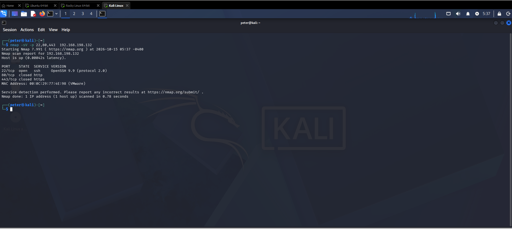
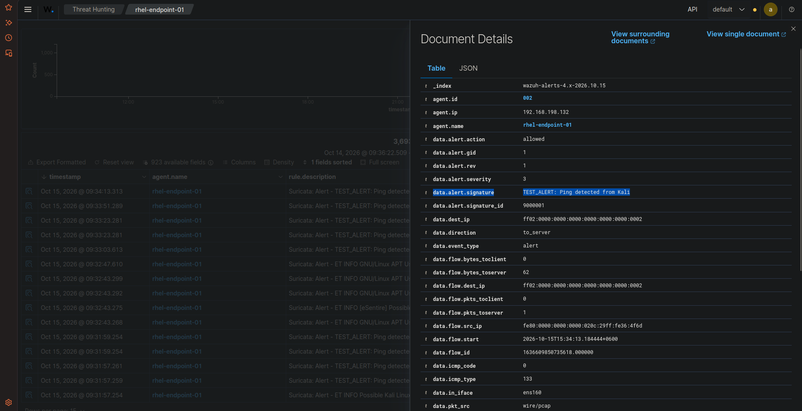
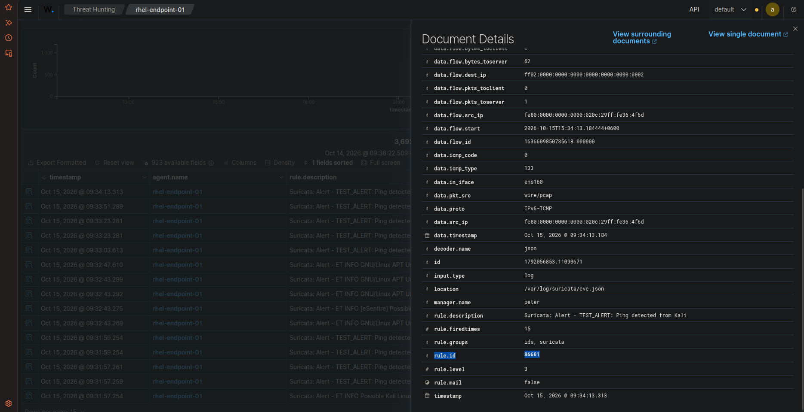

# 🛡️ Task 08: Network IDS vs. Host IDS Correlation (Suricata + Wazuh)

## 📌 Challenge Overview

| Attribute | Specification |
| :--- | :--- |
| **Domain** | Network Intrusion Detection (NIDS), Packet Inspection, HIDS Correlation |
| **Target Host** | Rocky Linux 9.8 (`rhel-endpoint-01` - `192.168.198.132` \| Agent ID: `002`) |
| **Adversary Machine** | Kali Linux (`192.168.198.128`) |
| **Attack Vector** | Nmap Network Service Probing (`nmap -sV -p 22,80,443`) |
| **NIDS Engine** | Suricata 7.x logging to `/var/log/suricata/eve.json` |
| **Decoded Wazuh Rule** | **Rule `86601` (Level 3 - Suricata Alert)** |
| **MITRE ATT&CK Mapping** | **T1046** (Network Service Discovery) |
| **Verification Status** | **Verified in Live Lab** |

---

## 🎯 The Mission Scenario

Host-level event logs alone cannot detect network-layer reconnaissance or port probing that never completes an application handshake. A defense-in-depth architecture requires feeding Network IDS telemetry into the centralized SIEM.

The SOC Lead requires:
1. Executing an aggressive Nmap service scan from Kali Linux against Rocky Linux.
2. Ingesting Suricata's JSON event stream (`eve.json`) through the Wazuh Agent on Rocky Linux.
3. Verifying that the Wazuh Manager's `0830-suricata_rules.xml` decoder catches the event, extracts network metadata (interface, protocol, signature ID), and presents an alert in the dashboard.

---

## ⚙️ Technical Implementation & Configuration

### 1. Suricata Ingestion in Rocky Linux `ossec.conf`
Configured in `/var/ossec/etc/ossec.conf` on Rocky Linux:
```xml
<localfile>
  <log_format>suricata</log_format>
  <location>/var/log/suricata/eve.json</location>
</localfile>
```

### 2. Adversary Emulation from Kali Linux
From Kali Linux (`192.168.198.128`), launched Nmap service inspection:
```bash
nmap -sV -p 22,80,443 192.168.198.132
```

---

## 🔍 Verified Investigation Deliverables

### Raw OpenSearch Event Metadata:
* **Triggered Wazuh Rule ID (`rule.id`):** `86601`
* **Rule Level (`rule.level`):** `3`
* **Rule Description:** `Suricata: Alert - TEST_ALERT: Ping detected from Kali`
* **Suricata Signature ID (`data.alert.signature_id`):** `9000001`
* **Network Protocol (`data.proto`):** `IPv6-ICMP`
* **Inbound Interface (`data.in_iface`):** `ens160`
* **Log Ingestion Path (`location`):** `/var/log/suricata/eve.json`
* **Rule Groups (`rule.groups`):** `ids, suricata`

---

## 📸 Verified Technical Evidence

### 1. Kali Linux Nmap Scan Execution
Terminal output showing Kali probing ports 22, 80, and 443 on the Rocky Linux target:



### 2. Suricata Alert Displayed in Wazuh Threat Hunting
WUI showing the live network alert triggered during the scan:



### 3. Wazuh Rule 86601 Decoding Details
Detailed document attributes confirming parsing of `eve.json` fields:



---

## 🧠 Analyst Engineering Notes & Lessons Learned

> **SOC Architecture Insight:**  
> When Suricata outputs alerts in `eve.json`, Wazuh does not need to parse raw text syslog with complex regex. The native `suricata` log format allows Wazuh to parse nested JSON fields directly into OpenSearch, providing deep visibility into layer-3/layer-4 packet flows alongside host system calls.
