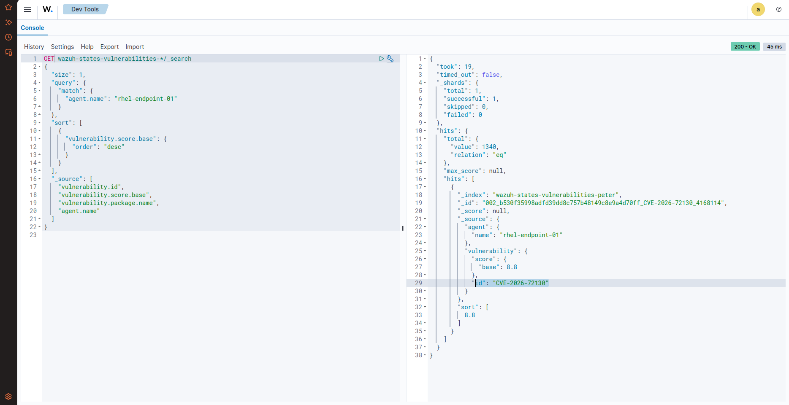
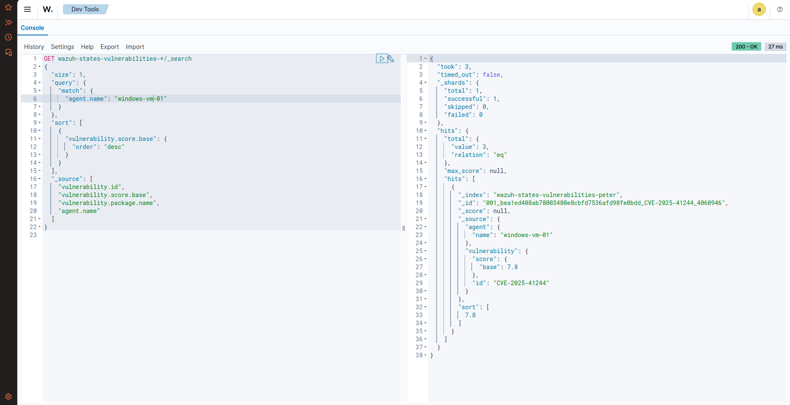
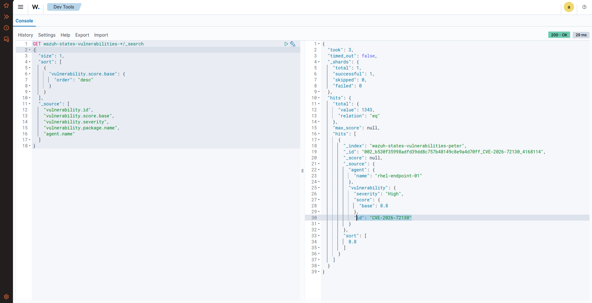
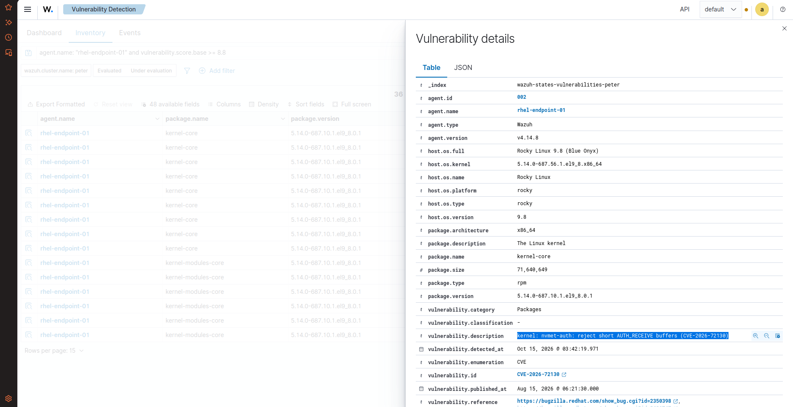
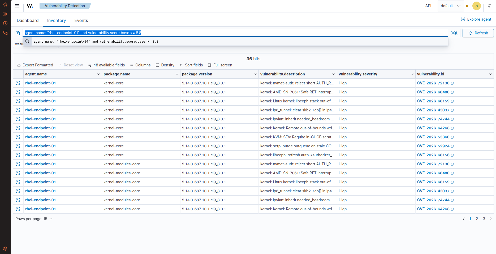

# 🛡️ Task 09: Vulnerability Posture & OpenSearch Dev Tools REST API

## 📌 Challenge Overview

| Attribute | Specification |
| :--- | :--- |
| **Domain** | Vulnerability Management, CVSS Base Scoring, OpenSearch Dev Tools REST API |
| **Target Hosts** | Rocky Linux 9.8 (`rhel-endpoint-01`) & Windows 11 Enterprise (`windows-vm-01`) |
| **Extraction Methods** | 1. Wazuh WUI Vulnerability Inventory<br>2. **OpenSearch Dev Tools REST API Console (`GET /_search`)** |
| **Top Linux Vulnerability** | **`CVE-2026-72130` (CVSS Base: `8.8` / High)** |
| **Top Windows Vulnerability**| **`CVE-2025-41244` (CVSS Base: `7.8` / High)** |
| **MITRE ATT&CK Mapping** | **T1190** (Exploit Public-Facing Application) |
| **Verification Status** | **Verified in Live Lab** |

---

## 🎯 The Mission Scenario

Executive leadership requests a risk briefing identifying the single highest-impact Common Vulnerabilities and Exposures (CVE) present on enterprise infrastructure to guide immediate patch cycles.

The SOC Lead requires:
1. Auditing software package inventories across both Windows 11 and Rocky Linux.
2. Identifying the maximum CVSS base score vulnerability on each host.
3. Providing CVE identifiers, vulnerable package names, installed versions, and severity classifications.

---

## 🚀 The Standout Achievement: Beyond the GUI to OpenSearch Dev Tools

While standard tier-1 analysts rely on point-and-click dashboard filters, I accessed the **OpenSearch Dev Tools Console** and execute raw JSON REST API queries directly against the underlying indices with multi-criteria descending sorts.

### 1. Rocky Linux Dev Tools REST Query
Executed directly against `wazuh-states-vulnerabilities-*`:

```json
GET wazuh-states-vulnerabilities-*/_search
{
  "size": 1,
  "query": {
    "match": {
      "agent.name": "rhel-endpoint-01"
    }
  },
  "sort": [
    {
      "vulnerability.score.base": {
        "order": "desc"
      }
    }
  ],
  "_source": [
    "vulnerability.id",
    "vulnerability.score.base",
    "vulnerability.package.name",
    "agent.name"
  ]
}
```

### JSON Query Response:
```json
{
  "took": 19,
  "timed_out": false,
  "hits": {
    "total": { "value": 1340, "relation": "eq" },
    "hits": [
      {
        "_index": "wazuh-states-vulnerabilities-peter",
        "_source": {
          "agent": { "name": "rhel-endpoint-01" },
          "vulnerability": {
            "score": { "base": 8.8 },
            "id": "CVE-2026-72130"
          }
        },
        "sort": [ 8.8 ]
      }
    ]
  }
}
```

### 2. Windows 11 Dev Tools REST Query
```json
GET wazuh-states-vulnerabilities-*/_search
{
  "size": 1,
  "query": {
    "match": {
      "agent.name": "windows-vm-01"
    }
  },
  "sort": [
    {
      "vulnerability.score.base": {
        "order": "desc"
      }
    }
  ],
  "_source": [
    "vulnerability.id",
    "vulnerability.score.base",
    "vulnerability.package.name",
    "agent.name"
  ]
}
```

### JSON Query Response:
```json
{
  "took": 3,
  "timed_out": false,
  "hits": {
    "total": { "value": 3, "relation": "eq" },
    "hits": [
      {
        "_index": "wazuh-states-vulnerabilities-peter",
        "_source": {
          "agent": { "name": "windows-vm-01" },
          "vulnerability": {
            "score": { "base": 7.8 },
            "id": "CVE-2025-41244"
          }
        },
        "sort": [ 7.8 ]
      }
    ]
  }
}
```

---

## 🔍 Verified Investigation Deliverables

### Executive Vulnerability Audit Summary:

| Host | Agent Name | Highest CVE | CVSS Score | Vulnerable Package | Package Version | Severity |
| :--- | :--- | :--- | :---: | :--- | :--- | :---: |
| **Rocky Linux 9.8** | `rhel-endpoint-01` | **`CVE-2026-72130`** | **`8.8`** | `kernel-core` | `5.14.0-687.10.1.el9_8.0.1` | **High** |
| **Windows 11** | `windows-vm-01` | **`CVE-2025-41244`** | **`7.8`** | Windows OS Component | Build 10.0.26200 | **High** |

---

## 📸 Verified Technical Evidence

### 1. Rocky Linux Dev Tools REST API Query
Shows execution of JSON query with descending CVSS sort returning `CVE-2026-72130` (Score: 8.8):



### 2. Windows 11 Dev Tools REST API Query
Shows REST query returning highest Windows CVE (`CVE-2025-41244`, Score: 7.8):



### 3. Global Highest Vulnerability Across All Fleet Nodes
Proves `rhel-endpoint-01` holds the maximum vulnerability score across the entire fleet:



### 4. Vulnerability Inventory in Wazuh Dashboard
GUI view of `kernel-core` package attributes and Red Hat advisory links:



### 5. High-Risk CVE Inventory Table (36 Hits)
List of 36 high-severity CVEs with score $\ge 8.8$:



---

## 🧠 Analyst Engineering Notes & Lessons Learned

> **SOC Engineering Notes:**  
> Constructing programmatic OpenSearch queries represents Tier-3 SOC / Threat Intelligence engineering work. This capability enables an analyst to automate vulnerability reporting via Python or bash cron scripts without being tethered to a web browser.
