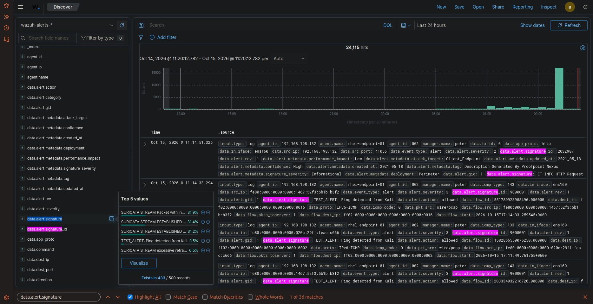
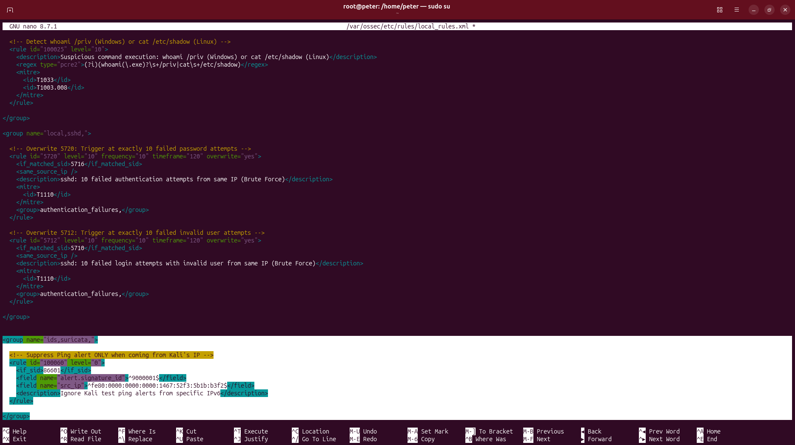

# 🛡️ Task 10: False Positive Tuning (SOC Noise Reduction)

## 📌 Challenge Overview

| Attribute | Specification |
| :--- | :--- |
| **Domain** | Detection Engineering, Alert Fatigue Mitigation & Rule Tuning |
| **Target Engine** | Ubuntu Wazuh Manager (`/var/ossec/etc/rules/local_rules.xml`) |
| **Parent Alert** | Rule `86601` (Suricata Ping Signature `9000001` - Level 3) |
| **Suppression Rule** | **Rule ID `100060`, Severity `level="0"` (Silent Drop)** |
| **Tuning Scope** | Benign internal security testing box (Kali Linux IPv6) |
| **MITRE ATT&CK Mapping** | **T1046** (Network Service Discovery) |
| **Verification Status** | **Verified in Live Lab** |

---

## 🎯 The Mission Scenario

In a production enterprise SOC, routine internal vulnerability scanners, penetration testing platforms, or automated health-check scripts frequently trigger hundreds of high-frequency alerts, causing severe alert fatigue and burying real attacks.

The SOC Lead requires:
1. Diagnosing the single most noisy alert signature in the enterprise environment.
2. Authoring a custom child suppression rule in `/var/ossec/etc/rules/local_rules.xml` using `<if_sid>` and `level="0"`.
3. Targeting the exact signature ID and source IP of the authorized testing box.
4. Ensuring that if an unauthenticated external attacker launches the exact same probe, the parent alert (`86601`) still fires!

---

## ⚙️ Technical Implementation & Suppression Engineering

### 1. Alert Noise Analysis
Analyzing OpenSearch telemetry revealed over **24,000 hits** generated in the environment, dominated by Suricata signature `9000001` (`TEST_ALERT: Ping detected from Kali`).

Attacker Source Identifiers Isolated:
* **Signature ID (`data.alert.signature_id`):** `9000001`
* **Source IPv6 Address (`src_ip`):** `fe80:0000:0000:0000:1467:52f3:5b1b:b3f2`

### 2. Custom Suppression Rule Definition
Authored inside `/var/ossec/etc/rules/local_rules.xml`:

```xml
<group name="ids,suricata,">
  <!-- Suppress Ping alert ONLY when coming from Kali's authorized test IP -->
  <rule id="100060" level="0">
    <if_sid>86601</if_sid>
    <field name="alert.signature_id">^9000001$</field>
    <field name="src_ip">^fe80:0000:0000:0000:1467:52f3:5b1b:b3f2$</field>
    <description>Ignore Kali test ping alerts from specific IPv6</description>
  </rule>
</group>
```

Restarted the manager daemon:
```bash
sudo systemctl restart wazuh-manager
```

---

## 🔍 How Wazuh Rule Inheritance Works

```
                        [Incoming Eve.json Packet Event]
                                       │
                                       ▼
                       [Rule 86601: Parent Suricata Match]
                                       │
                    Is signature_id == 9000001 AND
                    src_ip == fe80:...:b3f2 (Kali)?
                                 /          \
                                /            \
                             YES              NO
                             /                  \
                            ▼                    ▼
               [Rule 100060 (Level 0)]   [Rule 86601 (Level 3)]
                  SILENT SUPPRESSION         ALERT GENERATED
                  (Zero SOC Fatigue)     (Unknown Threat Detected)
```

1. **Precision Silencing:** The suppression applies exclusively when both the signature ID (`9000001`) and the specific authorized host IP match.
2. **Fail-Safe Security:** If an external threat actor on another IP address executes the same ping or scan, Rule `100060` does **not** match, and the parent alert (`86601`) fires immediately.

---

## 📸 Verified Technical Evidence

### 1. Alert Noise Analysis in OpenSearch Discover
Shows over 24,000 hits with Suricata signatures dominating the alert volume:



### 2. Production Suppression Rule in `local_rules.xml`
Terminal showing Rule `100060` authored in nano on the Ubuntu Manager:



---

## 🧠 Analyst Engineering Notes & Lessons Learned

> **SOC Operational Golden Rule:**  
> Never disable a parent rule globally (`<disabled>yes</disabled>`) to silence noise! Disabling a rule blinds the entire SOC to all future attacks matching that signature. Always use child rules with `level="0"` and exact criteria filters (`<field>`) to filter known benign noise while keeping the perimeter guarded.
